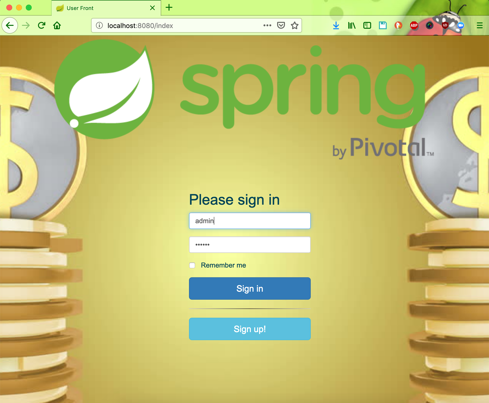
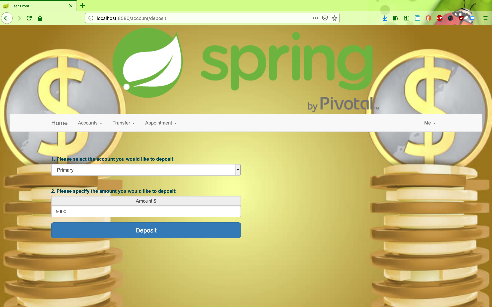
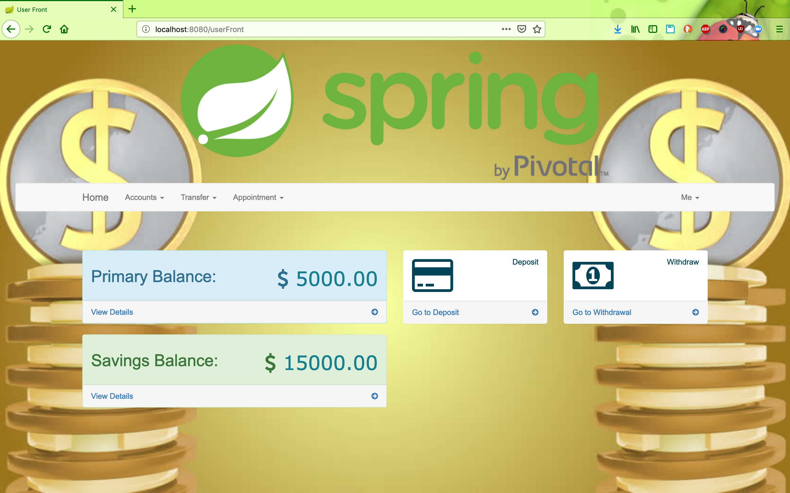

# Online-banking-angular-springboot-mysql

[](https://github.com/hendisantika/Online-banking-angular-springboot-mysql/actions/workflows/maven-publish.yml)
[](https://github.com/hendisantika/Online-banking-angular-springboot-mysql/actions/workflows/qodana_code_quality.yml)


Online-Bank-Simulator

Java 25 / Spring Boot 4.2 / Spring Data JPA / Spring Security / Hibernate / MySQL / Thymeleaf / REST

The project simulates an online banking system. It allows users to register/login, deposit/withdraw money from accounts, add/edit recipients, transfer money between accounts and recipients, view transactions, make appointments, and more.

There are two roles: **user** and **admin**.

## Features

### Core Banking Features
- User registration and authentication
- Primary and Savings accounts
- Deposit and withdraw money
- Transfer between own accounts
- Transfer to other recipients
- Transaction history

### New Features (v2.0)
- **Transaction Search & Filtering** - Search transactions by date range, type, and description
- **PDF Account Statements** - Download account statements as PDF for any date range
- **Daily Transaction Limits** - Configurable daily limits for withdrawals and transfers
- **Email Notifications** - Get notified for deposits, withdrawals, transfers, and low balance alerts
- **Password Reset** - Forgot password functionality with email reset link
- **Activity/Audit Logging** - Track all account activities for security
- **User Settings** - Configure daily limits and view activity logs

## Default Login Credentials

| Username | Password | Role |
|----------|----------|------|
| yu71     | 53cret   | USER |

## Requirements

- Java 25 (LTS)
- MySQL 8.0+
- Maven 3.9+ (or use the bundled Maven Wrapper `./mvnw`)
- Docker (optional, for containerized run & Testcontainers)

## Quick Start

### Clone the repository
```bash
git clone https://github.com/hendisantika/Online-banking-angular-springboot-mysql.git
cd Online-banking-angular-springboot-mysql
```

### Configure MySQL

Edit `src/main/resources/application.properties`:

```properties
spring.datasource.url=jdbc:mysql://localhost:3306/onlinebanking2?createDatabaseIfNotExist=true
spring.datasource.username=root
spring.datasource.password=root
```

### Configure Email (Optional)

For email notifications to work, configure SMTP settings in `application.properties`:

```properties
spring.mail.host=smtp.gmail.com
spring.mail.port=587
spring.mail.username=your-email@gmail.com
spring.mail.password=your-app-password
```

### Run the application
```bash
./mvnw clean spring-boot:run
```

Access the application at [http://localhost:8080](http://localhost:8080)

## Screenshots

### Sign Up Page


### Sign In Page


### Dashboard Page


### Deposit Page


### Dashboard Page


## Tech Stack

- **Language:** Java 25
- **Backend:** Spring Boot 4.2, Spring Security, Spring Data JPA
- **Database:** MySQL with Flyway migrations
- **Frontend:** Thymeleaf, Bootstrap, jQuery
- **PDF Generation:** OpenPDF 3.x (`org.openpdf` packages)
- **Email:** Spring Mail
- **Testing:** JUnit 5, Testcontainers (MySQL)
- **Build:** Maven, Docker (multi-stage, Eclipse Temurin 25)

## API Endpoints

### Public Endpoints
- `GET /` - Home page (redirects to login)
- `GET /signup` - Registration page
- `POST /signup` - Register new user
- `GET /password/forgot` - Forgot password page
- `POST /password/forgot` - Request password reset
- `GET /password/reset` - Reset password page
- `POST /password/reset` - Reset password

### User Endpoints (Authenticated)
- `GET /userFront` - User dashboard
- `GET /account/primaryAccount` - View primary account
- `GET /account/savingsAccount` - View savings account
- `POST /account/deposit` - Deposit money
- `POST /account/withdraw` - Withdraw money
- `GET /transfer/betweenAccounts` - Transfer between accounts
- `GET /transfer/recipient` - Manage recipients
- `GET /transfer/toSomeoneElse` - Transfer to recipient
- `GET /appointment/create` - Create appointment
- `GET /user/settings` - User settings
- `GET /user/activity` - Activity log
- `GET /statement/form` - Statement download form
- `GET /statement/download/primary` - Download primary account statement
- `GET /statement/download/savings` - Download savings account statement

### Admin Endpoints
- `GET /api/user/all` - List all users
- `GET /api/appointment/all` - List all appointments

## Deployment with Docker

### Start MySQL Docker Container
```bash
docker run --detach --name=bankmysql --env="MYSQL_ROOT_PASSWORD=root" -p 3306:3306 mysql:8
```

The `Dockerfile` uses a multi-stage build: `maven:3.9.11-eclipse-temurin-25` compiles the app and
`eclipse-temurin:25-jre` runs it.

### Build Docker image
```bash
docker build -t hendisantika/online-banking:latest .
```

### Run Docker container
```bash
docker run --detach -p 8080:8080 --link bankmysql:localhost -t hendisantika/online-banking:latest
```

## Deployment without Docker

### Build application
```bash
./mvnw clean package -DskipTests
```

### Run application
```bash
java -jar target/online-banking-0.0.1-SNAPSHOT.jar
```

## Project Structure

```
src/main/java/com/hendisantika/onlinebanking/
├── config/          # Configuration classes (Security, DataLoader)
├── controller/      # MVC Controllers
├── entity/          # JPA Entities
├── repository/      # Spring Data Repositories
├── resource/        # REST Controllers
├── security/        # Security entities (Role, UserRole)
└── service/         # Service layer

src/main/resources/
├── db/migration/    # Flyway SQL migrations
├── static/          # Static assets (CSS, JS, images)
├── templates/       # Thymeleaf templates
└── application.properties
```

## CI/CD & Dependency Management

- **Maven Package** (`.github/workflows/maven-publish.yml`) — builds and tests the project on JDK 25 (Temurin) for every push and pull request to `master`.
- **Qodana** (`.github/workflows/qodana_code_quality.yml`) — static code analysis with JetBrains Qodana (JDK 25).
- **Dependabot** (`.github/dependabot.yml`) keeps dependencies up to date:
  | Ecosystem | Schedule | Grouping | Commit prefix |
  |-----------|----------|----------|---------------|
  | Maven | daily 05:00 WIB | `spring-boot`, `testcontainers`, `maven-minor-patch` | `build(deps)` |
  | GitHub Actions | weekly (Monday) | all actions in one PR | `ci(deps)` |
  | Docker | weekly (Monday) | — (major JDK/Maven bumps ignored) | `build(deps)` |

## License

This project is open source and available under the [MIT License](LICENSE).

## Contributing

Contributions are welcome! Please feel free to submit a Pull Request.
